# Advanced Settings

Advanced settings provide precise control over mesh cleanup, adaptive reduction, UV generation, bake quality, image output, presets, diagnostics and memory safety.

Advanced is the most technical part of ScanReady. Here you can adjust the core workflow to go beyond the automatic result, refine a difficult scan or adapt the process to an asset intended for VR, video games or realtime use.

You do not need to change every setting to use ScanReady. For most scans, start with the defaults and make changes only when you need more control over quality, performance, bake accuracy or detail protection.

The settings follow the order of the add-on panel. The sections below explain what changes, when to intervene and which stage to regenerate after a change.

Work gradually: first create a low-poly preview with default settings, then return to Advanced only to correct something or improve the result.

  
Work step by step

  
If you change settings affecting the mesh, Adaptive Reduce or UVs, regenerate the corresponding step before continuing.

The main sections follow the workflow. Mesh Settings prepares and cleans the scan before the low-poly preview. Adaptive Reduce controls how ScanReady protects details, edges and normal changes during reduction. UV Settings manages the UV unwrap used for baking.

Bake Settings controls samples, margins, normal strength, image format, Occlusion options and memory safety. Base Color, Normal, Roughness and Occlusion maps are selected in Step 3. Presets, Diagnostics and Utilities help with heavy workflows, testing, reusing settings and quickly restoring a clean configuration.

  
<strong>Advanced</strong>

  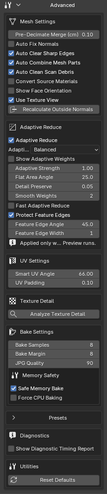

## Mesh Settings

These settings control scan preparation before the preview. Some affect the high-poly source: save a copy of the project before starting.

  
<strong>Mesh Settings</strong>

  

<h3>Pre-Decimate Merge</h3>

Performs Merge by Distance cleanup on the duplicated preview mesh before adding the Decimate modifier.

Merges preview vertices within the specified distance in centimeters. It does not automatically remove every overlapping face: use a small distance to avoid merging details that should remain separate.

  
If holes appear

  
If holes appear after optimization or thin details are affected, lower the value and recreate the low-poly preview.

  
<strong>Pre-Decimate Merge</strong>

  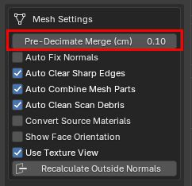

<h3>Auto Fix Normals</h3>

Automatically recalculates high-poly mesh normals before creating the low-poly preview.

Enable it when the scan has inverted normals, inconsistent shading or bake artifacts caused by incorrect normal directions.

  
<strong>Auto Fix Normals</strong>

  

  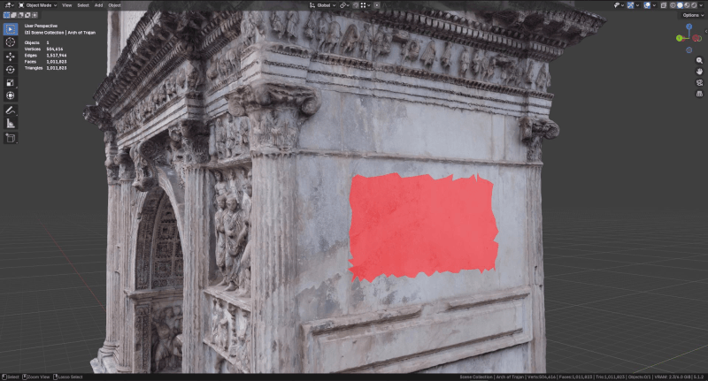

<h3>Auto Clear Sharp Edges</h3>

Automatically removes sharp-edge markings from the mesh during preparation.

This is useful when an imported scan has unwanted sharp edges that cause hard shading or less clean bakes.

  
<strong>Auto Clear Sharp Edges</strong>

  

  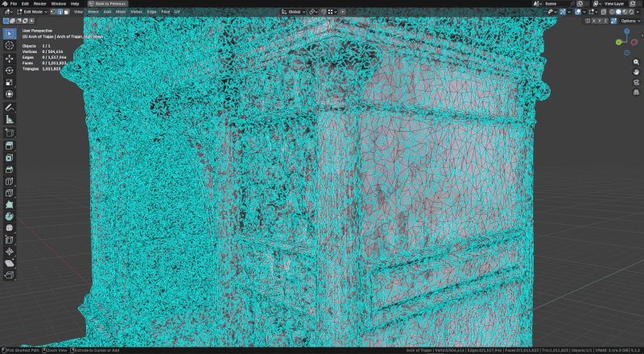

<h3>Auto Combine Mesh Parts</h3>

Automatically combines scan mesh parts when working with imports made of many separate objects. It is enabled by default.

ScanReady checks whether the selection contains a hierarchy with multiple meshes to combine. If the scan is already one mesh, it does not perform a merge.

Leave it enabled in most cases, especially for photogrammetry scans, GLB or FBX files split into multiple elements. Disable it only if automatic merging causes problems or you intentionally want to keep mesh parts separate.

  
<strong>Auto Combine Mesh Parts</strong>

  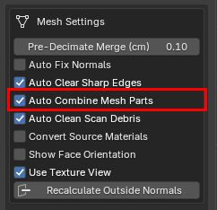

  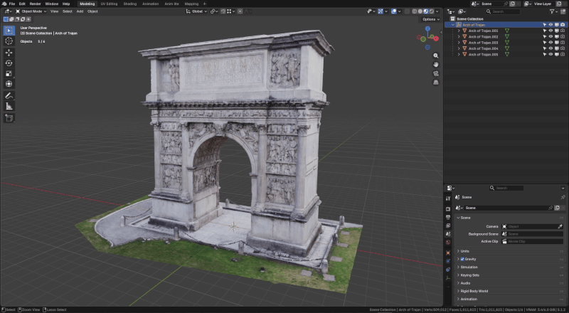

<h3>Auto Clean Scan Debris</h3>

Removes common scan debris such as isolated fragments, floating polygons and unnecessary vertices before reduction.

It is enabled by default because many raw scans contain small floating parts that can slow optimization, UVs and baking.

  
<strong>Auto Clean Scan Debris</strong>

  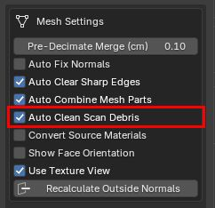

  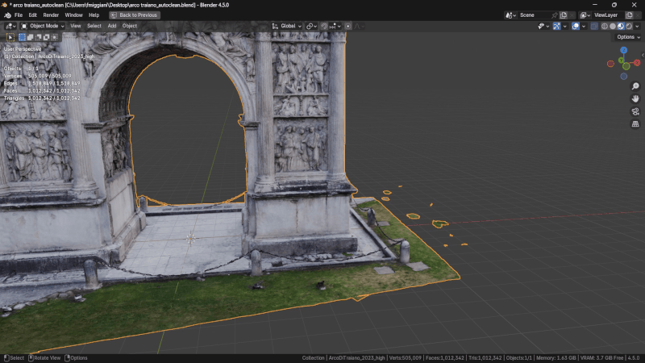

<h3>Convert Source Materials</h3>

Converts the scan's source materials into a cleaner, more predictable configuration for the ScanReady workflow.

Some imported models, especially from GLB files, Sketchfab or online libraries, can use complex materials or connections unsuitable for baking. For example, a diffuse texture may be connected to Emission instead of Base Color.

When this option is enabled, ScanReady checks the source materials.

  
When to convert materials

  
If ScanReady finds a standard <strong>Principled BSDF</strong> material, it leaves it unchanged and only protects the material and textures with fake users.

  
If it finds complex imported shaders, it rebuilds a cleaner, more predictable material.

It is disabled by default. Enable it only if the bake does not turn out well, for example if Base Color is black, incomplete or inconsistent, or imported materials are not read correctly by ScanReady.

  
<strong>Convert Source Materials</strong>

  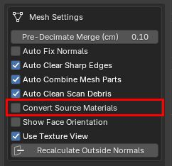

  

    
    

      
    

    Original material
    Converted material
    <strong>Non-standard nodes</strong><small>Imported shader</small>
    <strong>Principled BSDF</strong><small>Standard material</small>
    <button class="sr-uv-compare__handle" type="button" aria-label="Compare the original material and the material converted to Principled BSDF" aria-valuemin="0" aria-valuemax="100" aria-valuenow="50"></button>
  

<strong>Move the slider to compare the original and converted materials.</strong>

<h3>Show Face Orientation</h3>

Shows Blender's <strong>Face Orientation</strong> overlay to quickly check whether model faces are oriented correctly.

In Blender, faces have a direction: one side is considered outside and the other inside. Inverted faces may look correct in the viewport but cause black areas, missing details, incorrect shadows or badly transferred textures during baking.

Use <strong>Show Face Orientation</strong> before creating the low-poly preview or baking to check for inverted normals. Faces highlighted in red normally indicate surfaces facing the wrong way and can cause bake problems.

When you enable <strong>Show Face Orientation</strong>, ScanReady automatically disables <strong>Backface Culling</strong> to avoid overlapping visual checks.

  
Show Face Orientation and Backface Culling

  
The two controls are intended for different checks and are mutually exclusive, keeping the viewport readable.

  
<strong>Show Face Orientation</strong>

  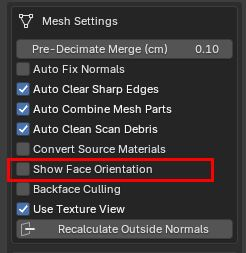

  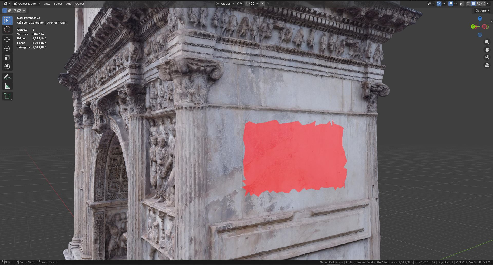

<h3>Backface Culling</h3>

Enables viewport <strong>Backface Culling</strong> to check how faces behave when viewed from behind.

This display mode helps identify scan problems such as inverted faces, single-sided surfaces, holes, open parts or suspiciously oriented areas.

This check is important before baking: incorrectly oriented faces or open parts can cause black textures, missing details, incorrect shadows or incorrect transfers from the high-poly mesh to the optimized mesh, even if the model looks correct in the viewport.

<strong>Backface Culling</strong> is only a preview mode: it does not modify the mesh or directly change the bake. It helps inspect the scan before proceeding.

Backface Culling and Show Face Orientation are linked: enabling one automatically disables the other, so you inspect the scan with one diagnostic mode at a time.

  
<strong>Backface Culling</strong>

  

  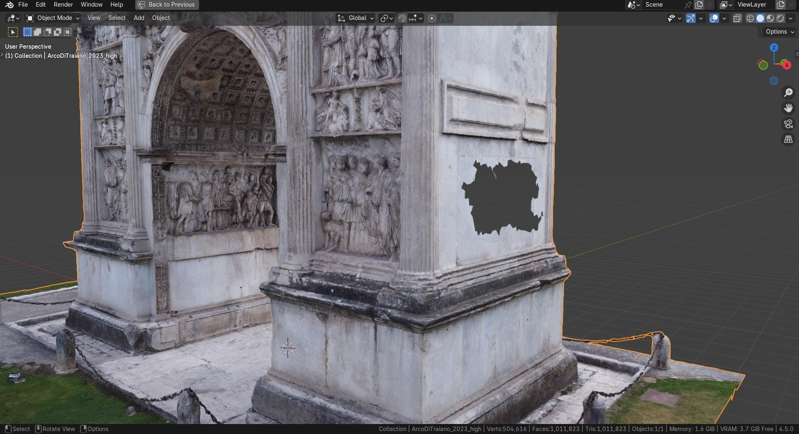

<h3>Use Texture View</h3>

Enables Material Preview without scene lights and World. If Backface Culling is active, it instead uses Solid view with textures and flat lighting.

It helps inspect baked texture results or previews more clearly.

  
<strong>Use Texture View</strong>

  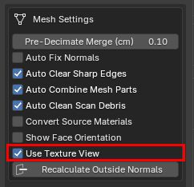

  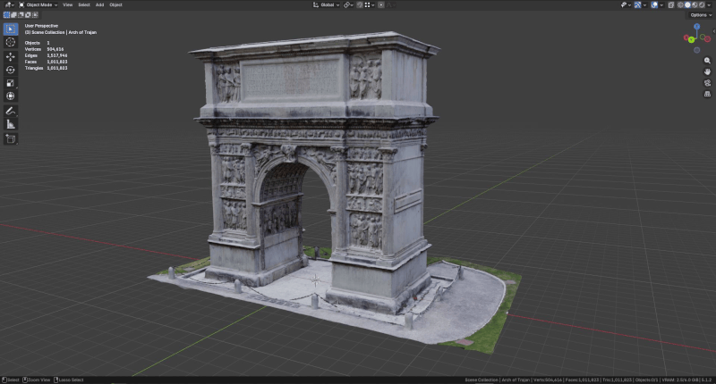

<h3>Recalculate Outside Normals</h3>

Recalculates outward-facing normals on the high-poly source associated with the selection.

Use it when the scan looks inside out or has inconsistent shading.

  
<strong>Recalculate Outside Normals</strong>

  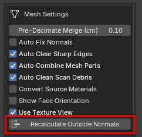

  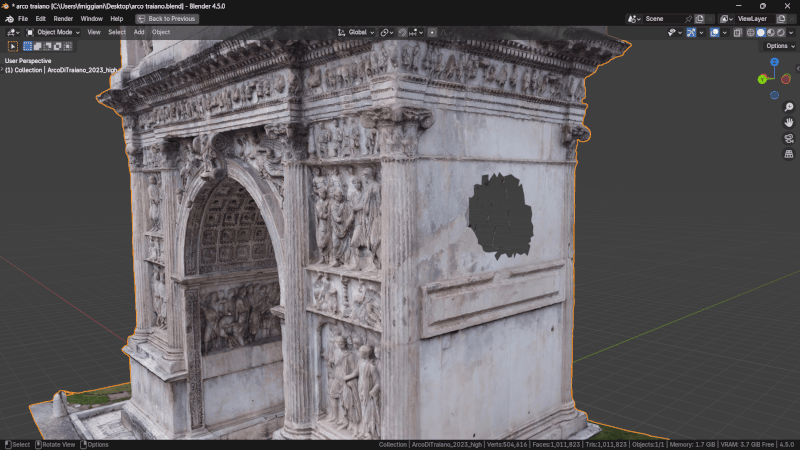

---

## Adaptive Reduce

Adaptive Reduce controls how ScanReady distributes reduction across the selected scan.

It is enabled by default and is designed to protect visually important detail while allowing flat surfaces to be simplified more.

Adaptive Reduce weights are calculated when you click <strong>Create Lowpoly Preview</strong>.

  

  
Minimum reductionMedium reductionHigh reduction

  
When to recalculate weights

  
Changing <strong>Optimize / Reduce</strong> or <strong>Final Faces</strong> afterwards updates the amount of reduction, but does not recalculate adaptive weights.

  
To apply a different Adaptive Reduce preset or detailed adaptive values, recreate the low-poly preview.

  
<strong>Adaptive Reduce</strong>

  

<h3>Adaptive Reduce</h3>

Enables or disables the adaptive reduction system.

When enabled, ScanReady analyzes the mesh and creates weights to protect important details, edges and normal changes while simplifying flat or less important areas more.

  
<strong>Adaptive Reduce</strong>

  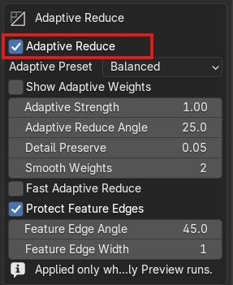

<h3>Adaptive Method</h3>

<strong>Best Quality</strong> is the recommended method. It first identifies large planar areas, then recovers persistent curvature, decorations and coherent reliefs. This allows noisy walls, floors and roofs to be reduced without treating real detail as mere scan noise.

<strong>Legacy</strong> retains the original Adaptive Reduce calculation. Use it for compatibility with older projects or to compare a particular scan with previous behavior.

  
<strong>Adaptive Method</strong>

  

<h3>Adaptive Preset</h3>

Choose the preset best suited to the scan and target asset.

<ul>
<li><strong>Balanced</strong> is the default preset for most scans.</li>
<li><strong>Preserve Details</strong> more strongly protects complex or important surface regions.</li>
<li><strong>Flat Surfaces</strong> reduces broad, simple areas more aggressively.</li>
</ul>

  
<strong>Adaptive Preset</strong>

  

<h3>Show Adaptive Weights</h3>

Shows a color preview of how ScanReady will distribute reduction across the scan.

Red areas represent flatter surfaces that can be reduced more. Blue and green areas represent regions protected for detail.

The display is only a preview aid. It helps choose the preset and understand reduction behavior; it is not an exported or baked texture.

When the color map is active, ScanReady temporarily hides the wireframe for readability. Disabling Show Adaptive Weights restores the previous Show Wireframe setting.

  
Previously calculated weights

  
Adaptive Reduce weights are calculated when you click <strong>Create Lowpoly Preview</strong>.

  
After the preview exists, changing <strong>Optimize / Reduce</strong> or <strong>Final Faces</strong> updates the amount of reduction using the existing weights.

  
If you change a preset or detailed Adaptive Reduce values, click <strong>Create Lowpoly Preview</strong> again to rebuild weights with the new settings.

Use this preview for scans with mixed surfaces, such as flat architectural panels alongside sculptural or damaged details.

  
<strong>Show Adaptive Weights</strong>

  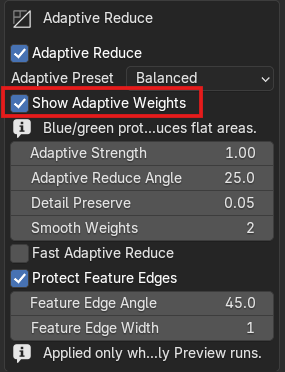

  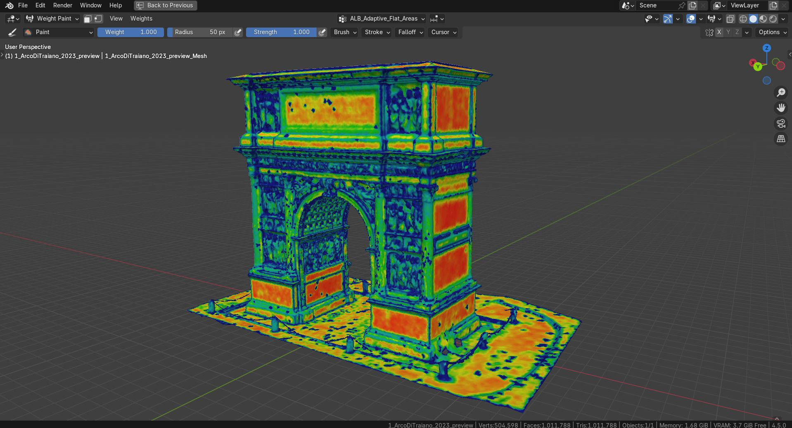

<h3>Adaptive Strength</h3>

This control appears only with the <strong>Legacy</strong> method and adjusts how strongly the original map affects reduction.

Best Quality does not use Adaptive Strength; it uses <strong>Adaptive Decimate Factor</strong> instead.

  
<strong>Adaptive Strength</strong>

  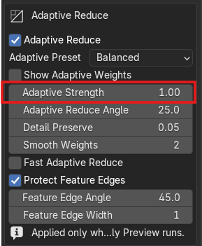

<h3>Adaptive Reduce Angle</h3>

Controls sensitivity to normal changes used to distinguish flat areas, curvature and details.

Lower values make ScanReady more sensitive to surface variations. Higher values tend to treat more areas as relatively uniform.

  
<strong>Adaptive Reduce Angle</strong>

  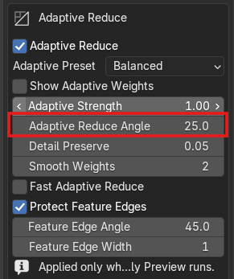

<h3>Detail Preserve</h3>

Sets the minimum reduction weight assigned to areas recognized as detail.

Lower values protect detected detail more. Higher values allow Decimate to reduce more even in detailed areas.

  
<strong>Detail Preserve</strong>

  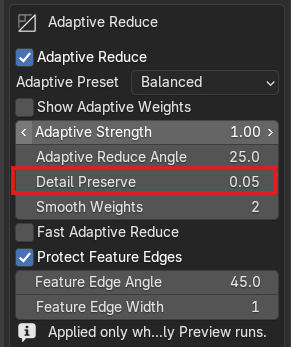

<h3>Smooth Weights</h3>

Smooths Adaptive Reduce weights to make the transition between protected and reduced areas more even.

Higher values can produce a less jagged distribution, useful for noisy scans or irregular surfaces.

  
<strong>Smooth Weights</strong>

  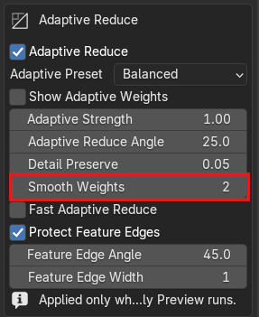

### Best Quality Analysis Controls

| Parameter | Balanced | What it controls | Increase / decrease |
|---|---:|---|---|
| **Complexity Sensitivity** | 0.75 | How easily persistent curvature and geometric changes are classified as detail. | Increase for more green/blue and protected geometry; decrease for more aggressive reduction. |
| **Flat / Detail Contrast** | 1.30 | Separation between red planar and protected blue areas. | Increase for a sharper transition; decrease for a softer gradient. |
| **Detail Spread Rings** | 1 | How many neighboring vertex rings receive detected-detail protection. | Increase when reliefs, frames or decorations need surrounding support. High values can protect overly broad areas. |
| **Noise Rejection** | 0.85 | How much isolated variations that do not persist in the surrounding region are attenuated. | Increase to ignore more scan noise; decrease to retain more fine variations, including possible noise. |
| **Analysis Scale** | 4 | Number of connected rings used to distinguish coherent shape from local noise. | Increase for broader, slower analysis; decrease for a more local, noise-sensitive response. |
| **Adaptive Decimate Factor** | 2.0 | How strongly the weight map affects Decimate. It does not change the colors or how the map is calculated. | Normally use 1–5. Very high values accentuate the difference between red and blue but can create long or radial triangles. |

!!! tip "Recommended adjustment"
    Always start with **Balanced** and **Adaptive Decimate Factor 2**. Change one parameter at a time, recreate the preview and check both the color map and resulting wireframe.

<h3>Fast Adaptive Reduce</h3>

Uses a faster, approximate adaptive calculation mode.

It uses fewer neighbors, a smaller analysis scale, no final smoothing and at most one detail-expansion ring. Useful for quick tests on very dense scans; disable it for the final quality check.

  
<strong>Fast Adaptive Reduce</strong>

  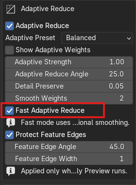

<h3>Protect Feature Edges</h3>

Protects important edges and sharp surface breaks during reduction.

Recommended for hard-surface scans, vehicles, architecture, objects with visible edges or important silhouettes.

  
<strong>Protect Feature Edges</strong>

  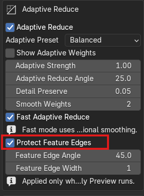

<h3>Feature Edge Angle</h3>

Defines the minimum angle used to consider an edge a feature edge that should be protected.

Lower values protect more edges. Higher values protect only sharper direction changes.

  
<strong>Feature Edge Angle</strong>

  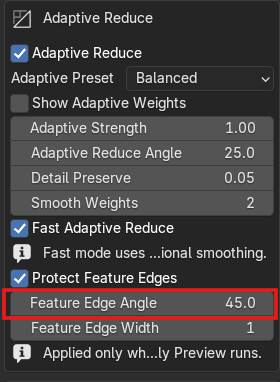

<h3>Feature Edge Rings</h3>

Extends feature-edge protection to neighboring geometry rings.

This can help keep the shape more stable around sharp edges, frames, panels or prominent scan boundaries.

  
<strong>Feature Edge Rings</strong>

  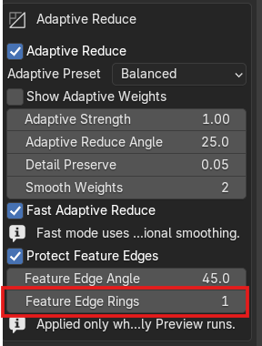

---

## UV Settings

These settings control how Smart UV Project unwraps the optimized mesh.

  
When UV settings are applied

  
UV settings are applied when ScanReady generates UVs.

  
If you change UV values after creating the layout, click <strong>Generate UVs</strong> again or run <strong>One Click Bake</strong> from the beginning.

  
<strong>Bake Textures</strong> always uses the UV layout that already exists at bake time.

  
<strong>UV Settings</strong>

  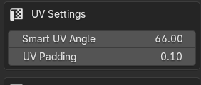

<h3>Smart UV Angle</h3>

Controls how much Smart UV Project divides the mesh into UV islands.

<ul>
<li>Lower values create more cuts and more UV islands.</li>
<li>Higher values create larger islands.</li>
</ul>

You can adjust this value manually for more control over the unwrap used for baking.

Adaptive Reduce presets are separate from UV generation: Adaptive Reduce controls mesh simplification, while Smart UV Project controls the UV unwrap.

  
<strong>Smart UV Angle</strong>

  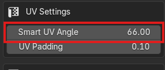

<h3>UV Padding</h3>

Sets the space between UV islands.

Increase padding to reduce texture bleeding, especially at lower texture resolutions.

  
<strong>UV Padding</strong>

  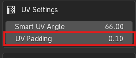

---

## Texture Detail

This section is in <strong>Advanced</strong> after <strong>UV Settings</strong> and before <strong>Bake Settings</strong>.

It analyzes the high-poly source and optimized UV mesh to estimate whether the current texture size and number of bake materials can preserve enough scan detail.

Use <strong>Analyze Texture Detail</strong> after generating UVs and before baking when you want help deciding whether to increase texture resolution, increase bake materials or improve UV packing.

  
<strong>Texture Detail</strong>

  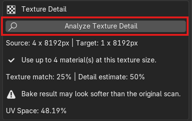

---

## Bake Settings

These settings control samples, margin, normal strength, image format quality, Occlusion options and memory safety.

In the add-on, <strong>Occlusion Settings</strong> and <strong>Memory Safety</strong> are inside <strong>Bake Settings</strong>. Some controls appear only when the corresponding option is enabled.

  
<strong>Bake Settings</strong>

  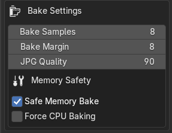

<h3>Bake Samples</h3>

Sets the number of Cycles samples used for baking.

Higher values can reduce noise, especially for Ambient Occlusion, but also increase bake time.

  
<strong>Bake Samples</strong>

  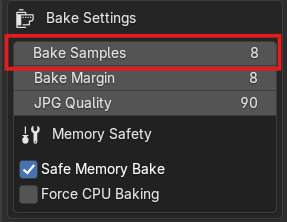

<h3>Bake Margin</h3>

Adds pixel padding around baked UV islands.

It helps reduce visible seams and texture bleeding.

  
<strong>Bake Margin</strong>

  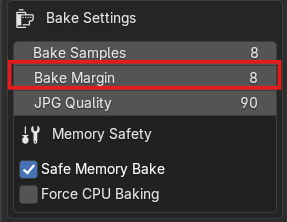

<h3>Normal Strength</h3>

Appears when <strong>Bake Normal Map</strong> is enabled.

Controls the strength of the Normal Map node in the final material. It changes only the material's appearance, not the baked normal texture.

If <strong>Bake Normal Map</strong> is disabled, this control does not appear and the image format control, such as <strong>JPG Quality</strong>, appears directly after <strong>Bake Margin</strong>.

  
<strong>Normal Strength</strong>

  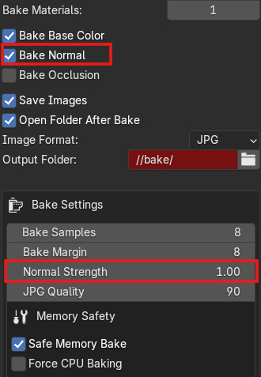

<h3>JPG Quality</h3>

Controls JPG compression quality when JPG is the selected image format.

Higher values preserve more image detail but produce larger files.

  
<strong>JPG Quality</strong>

  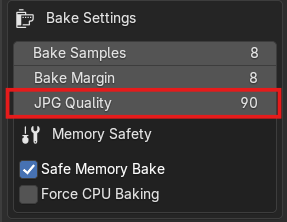

<h3>TIFF 16-bit</h3>

Enables higher-precision TIFF output when TIFF is selected.

This can be useful for detailed assets, archival workflows or technical texture output.

  
<strong>TIFF 16-bit</strong>

  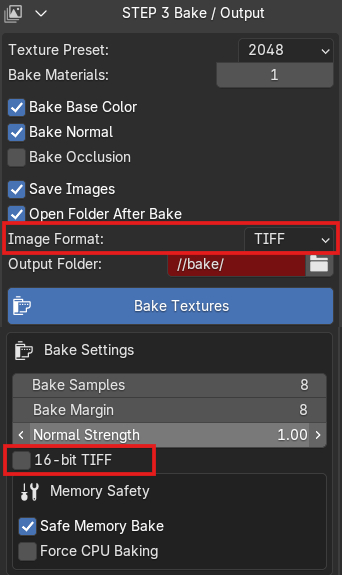

---

### Occlusion Settings

These options are inside <strong>Bake Settings</strong> and appear when <strong>Bake Occlusion Map</strong> is enabled.

  
<strong>Occlusion Settings</strong>

  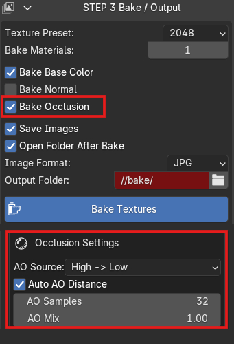

<h4>AO Source</h4>

Controls whether Ambient Occlusion is baked from the high-poly source to the low-poly target or calculated only from the low-poly mesh.

  
<strong>AO Source</strong>

  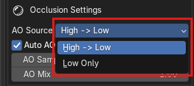

<h4>Auto AO Distance</h4>

Automatically calculates AO distance based on model size.

  
<strong>Auto AO Distance</strong>

  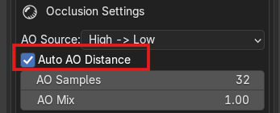

<h4>AO Distance</h4>

Manual AO ray distance when automatic distance is disabled.

  
<strong>AO Distance</strong>

  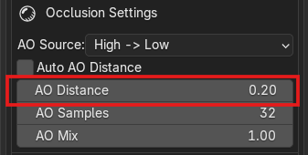

<h4>AO Samples</h4>

Controls Ambient Occlusion bake quality.

Higher values produce cleaner AO but increase bake time.

  
<strong>AO Samples</strong>

  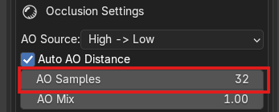

<h4>AO Mix</h4>

Controls how much the baked Ambient Occlusion texture darkens the final Base Color material.

The default value is <strong>1.0</strong>, which uses the full baked AO texture in the final material. Lower values make the AO effect subtler.

  
<strong>AO Mix</strong>

  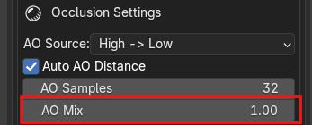

---

### Memory Safety

These options are inside <strong>Bake Settings</strong> and help reduce memory problems during demanding bake operations.

  
<strong>Memory Safety</strong>

  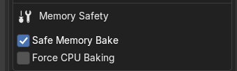

<h4>Safe Memory Bake</h4>

Uses a safer baking workflow designed to reduce memory pressure for large scans and heavy Blender scenes.

Leave it enabled when working with dense photogrammetry assets or high texture resolutions.

  
<strong>Safe Memory Bake</strong>

  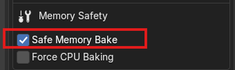

<h4>Force CPU Baking</h4>

Performs the bake on the CPU when GPU VRAM is insufficient. It still requires enough system RAM.

It is usually slower but can be safer on systems with little VRAM.

ScanReady can enable it automatically when multi-material baking is used.

  
<strong>Force CPU Baking</strong>

  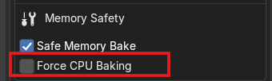

---

## Presets

ScanReady can save, reload and delete named presets.

Presets save current workflow settings so you can reuse them later.

Use presets when working on multiple scans with similar requirements, such as:

<ul>
<li>VR assets;</li>
<li>game props;</li>
<li>museum objects;</li>
<li>repeated bake settings;</li>
<li>standard studio workflows.</li>
</ul>

  
<strong>Preset</strong>

  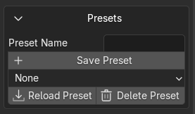

<h3>Preset Name</h3>

Defines the name of the preset to save.

  
<strong>Preset Name</strong>

  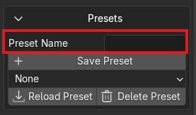

<h3>Save Preset</h3>

Saves workflow parameters: mesh, reduction, display, UVs, cage, textures, bake, memory and output folder. It does not save scene objects, generated images or update preferences.

When reloading a preset, also check <strong>Output Folder</strong> before starting a new bake.

  
<strong>Save Preset</strong>

  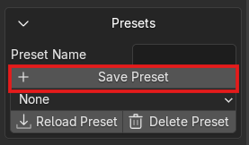

<h3>Preset Selector</h3>

Lets you choose an existing preset.

  
<strong>Preset Selector</strong>

  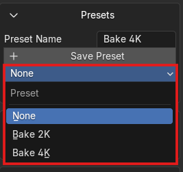

<h3>Reload Preset</h3>

Loads the selected preset.

  
<strong>Reload Preset</strong>

  

<h3>Delete Preset</h3>

Deletes the selected preset.

  
<strong>Delete Preset</strong>

  

---

## Diagnostics

Diagnostic options help you see what ScanReady is doing during testing or performance optimization.

  
<strong>Diagnostics</strong>

  

<h3>Show Diagnostic Timing Report</h3>

Shows a detailed timing report after <strong>ONE CLICK BAKE</strong>.

The report can include Preview / Reduce, Generate UVs, Auto Cage, Bake / Finalize, Adaptive / Decimate and individual bake sub-stage times.

  
Recommended use

  
Keep <strong>Show Diagnostic Timing Report</strong> disabled during videos, demos and normal use. Enable it to compare performance or find out which stage takes the most time.

It is disabled by default to keep the panel cleaner during normal use, demos and videos. Enable it only when analyzing performance or comparing settings.

  
<strong>Show Diagnostic Timing Report</strong>

  

---

## Utilities

Utility tools help reset or restore the add-on configuration.

  
<strong>Utilities</strong>

  

<h3>Reset Defaults</h3>

Restores ScanReady settings to their default values.

Use it if current settings produce unexpected results or you want to return to a clean configuration.

  
<strong>Reset Defaults</strong>

  

---

## Addon Preferences / Updates

ScanReady includes a small support section in Blender Add-on Preferences.

Here you can check the installed version, manually check for a newer version, open the documentation, read release notes and reach video tutorials.

Official updates are installed through Blender Extensions / Superhive. ScanReady's internal check is informational and only reports that a newer version is available.

  
<strong>Addon Preferences / Updates</strong>

  

<h3>Installed version</h3>

Shows the ScanReady version currently installed in Blender.

Use it to quickly check which build you are using before comparing it with a published release.

  
<strong>Installed version</strong>

  

<h3>Check for Updates</h3>

Manually checks whether a newer ScanReady version exists.

ScanReady reads the public <strong>update-manifest.json</strong> file from the documentation and compares the available version with the installed version.

  
Informational check

  
<strong>Check for Updates</strong> does not install updates and does not replace Blender Extensions / Superhive. It is only a manual notification, also useful when the add-on was installed from ZIP.

  
<strong>Check for Updates</strong>

  

<h3>Update Notice</h3>

When ScanReady detects a newer version, it can show a notice in the panel with the installed and available versions.

The notice appears after a manual check detects a newer version. To update, download the package from the purchase platform or use Update if ScanReady was installed from an extension repository configured in Blender.

  
<strong>Update Notice</strong>

  

  
<strong>Update check in Preferences</strong>

  

<h3>Open Documentation</h3>

Opens the online ScanReady documentation.

Use it to consult the quick guide, manual workflow, FAQ, troubleshooting or settings reference.

  
<strong>Open Documentation</strong>

  

<h3>Release Notes</h3>

Opens the ScanReady changelog and release notes page.

Use it to see what changed before installing or comparing a new version.

  
<strong>Release Notes</strong>

  

<h3>Video Tutorials</h3>

Opens the YouTube channel with ScanReady tutorials.

Use it when you prefer following the workflow on video or want practical add-on examples.

  
<strong>Video Tutorials</strong>

  

---

## Practical Advice

For VR, video games and realtime workflows, always balance quality and performance.

Use advanced settings to find the right compromise between:

- mesh cleanup;
- UV quality;
- bake quality;
- texture resolution;
- file size;
- memory usage;
- realtime performance.

The goal is not to preserve every polygon of the original scan.

The goal is to preserve the scan's visual identity in a lighter asset that is easier to use.

