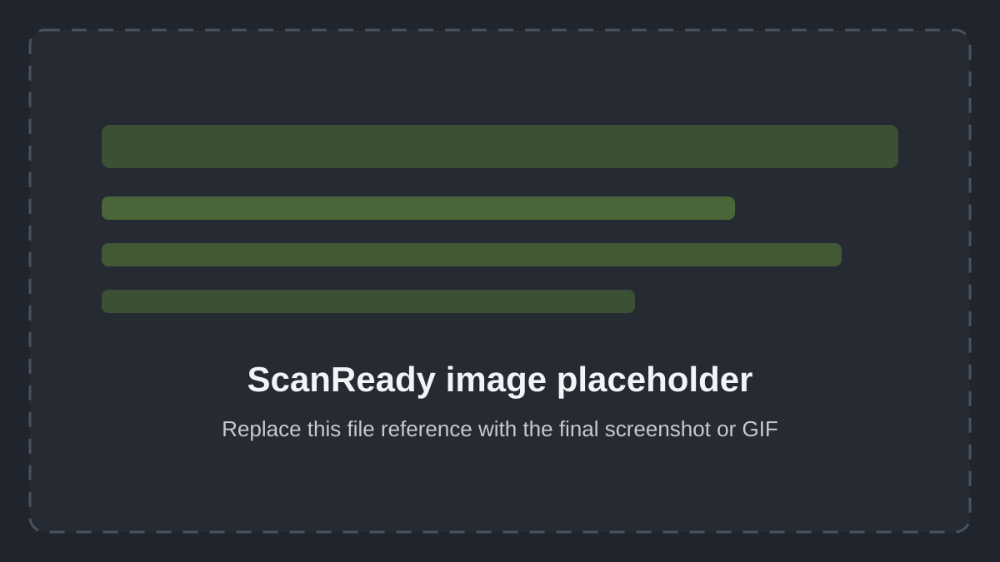
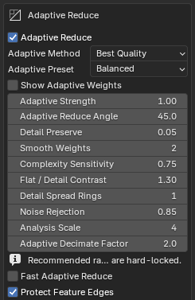
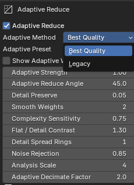
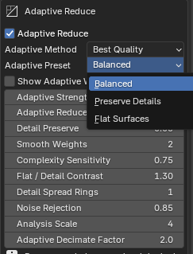

# Advanced Settings

Advanced settings give you fine control over mesh cleanup, UV generation, baking quality, image output, presets, utilities, and memory safety.

You do not need to change every setting to use ScanReady 1.0.

For most scans, start with the default values. Adjust advanced settings only when you need more control over performance, quality, or bake accuracy.

<!-- Replace placeholder with ../img/advanced-overview.png -->

  

# Mesh Settings

These settings control scan cleanup and mesh preparation before generating the low-poly preview.

<h3>Pre-Decimate Merge</h3>

Runs a Merge by Distance cleanup on the duplicated preview mesh before the Decimate modifier is added.

This is the single explicit weld control in ScanReady 1.0. It can help reduce overlapping scan polygons before optimization. If thin details are affected, lower the value and create the low-poly preview again.

<h3>Auto Fix Normals</h3>

Automatically recalculates high-poly mesh normals before creating the low-poly preview.

Enable this when the scan has inverted normals, broken shading, or bake artifacts caused by incorrect normal direction.

<h3>Use Texture View</h3>

Displays the model in a flat texture-oriented view without scene lighting.

This is useful for inspecting baked or previewed texture results more clearly.

<h3>Recalculate Outside Normals</h3>

Runs normal recalculation manually on the selected high-poly mesh.

Use this when the scan appears inside-out or has inconsistent shading.

  <!-- Replace placeholder with ../img/advanced-mesh-settings.png -->
  

---

# Adaptive Reduce

Adaptive Reduce creates a vertex-weight map before Blender Decimate runs. High weights identify surfaces that can be simplified more strongly; low weights protect coherent detail, borders, and feature edges.

  

## Adaptive Method

- **Best Quality** is the recommended method. It first finds broad planar areas, then restores persistent curvature and decoration detail. It is designed to keep noisy walls and floors reducible without treating coherent relief as disposable scan noise.
- **Legacy** keeps the original ScanReady Adaptive Reduce calculation for compatibility with older projects or unusual scans that respond better to the previous weighting.

  

## Adaptive Preset

- **Balanced** is the recommended default and uses the settings validated for mixed architectural scans.
- **Preserve Details** protects sculptural forms, engravings, rocks, damage, and small coherent relief more strongly.
- **Flat Surfaces** favors stronger reduction on broad walls, roofs, floors, panels, and bases.

  

## Reading Adaptive Weights

Enable **Show Adaptive Weights** after creating a low-poly preview:

- **Red / orange** means the region is considered flat and can receive stronger reduction.
- **Green** is a transition region.
- **Blue** means coherent detail or a protected edge should retain more geometry.

While the color map is active, ScanReady temporarily hides the wireframe so it remains readable. Disabling Show Adaptive Weights restores the previous Show Wireframe preference. The colors are only a viewport diagnostic and are not exported or baked.

## Best Quality controls

| Setting | Balanced | What it controls | Increase / decrease |
|---|---:|---|---|
| **Adaptive Reduce Angle** | 45° | Reference angle used when separating planar regions from meaningful normal changes. | Lower values recognize smaller changes as detail. Higher values allow broader smooth regions to remain reducible. |
| **Detail Preserve** | 0.05 | Minimum Decimate weight assigned to protected detail. | Lower values protect detected detail more strongly. Higher values allow more reduction inside detail regions. |
| **Smooth Weights** | 2 | Number of passes used to smooth the final weight map across connected vertices. | Increase it for softer, more continuous transitions; excessive values can spread flat/detail classifications too far. |
| **Complexity Sensitivity** | 0.75 | Sensitivity to persistent curvature and geometric change. | Higher values classify more geometry as detail and produce more green/blue. Lower values classify more of the scan as reducible. |
| **Flat / Detail Contrast** | 1.30 | Separation between flat red zones and protected blue zones. | Higher values create a sharper separation. Lower values create a softer gradient. |
| **Detail Spread Rings** | 1 | Number of connected vertex rings into which detected detail is expanded. | Increase it when ridges or decorations need surrounding support; high values can protect too wide an area. |
| **Noise Rejection** | 0.85 | Suppression of changes that do not persist across the surrounding region. | Higher values reject more isolated scan noise. Lower values preserve more fine variation, including possible noise. |
| **Analysis Scale** | 4 | Number of connected rings used to distinguish persistent form from local noise. | Higher values analyze a broader neighborhood and cost more time. Lower values are more local and can react more strongly to scan noise. |
| **Adaptive Decimate Factor** | 2.0 | Strength of the weight map inside Blender's Decimate modifier. It does not change the colors themselves. | Values around 1–5 are recommended. Higher values exaggerate the difference between red and blue and can produce long or radial triangles. |

## Shared and edge-protection controls

- **Fast Adaptive Reduce** uses fewer neighbor samples, a smaller analysis support, no final smoothing, and at most one detail-spread ring. Use it for quick tests on dense scans; disable it for the final quality check.
- **Protect Feature Edges** protects mesh boundaries and edges whose face-normal angle passes the selected threshold.
- **Feature Edge Angle** sets that threshold. Lower values protect more edges; higher values protect only sharper breaks.
- **Feature Edge Rings** expands protection into neighboring vertex rings so arches, bevels, frames, and silhouettes keep enough support.
- **Adaptive Strength** appears only with **Legacy**. It controls how strongly the original weight map influences Decimate; Best Quality uses Adaptive Decimate Factor instead.

!!! note "When to recreate the preview"
    Adaptive weights are calculated when you click **Create Low-poly Preview**. Changing the method, preset, or any analysis/detail/edge setting requires creating the preview again. Changing **Optimize / Reduce** or **Final Faces** changes the reduction target but does not recalculate the color map. Adaptive Decimate Factor does not generate new weights, but use **Create Low-poly Preview** to apply its new value through the ScanReady interface.

---

# UV Settings

These settings control how Smart UV Project unwraps the optimized mesh.

Smart UV settings are applied when ScanReady generates UVs. If you change the Smart UV preset, Smart UV Angle, UV Padding, or Auto Pack UV after UVs already exist, click **Generate UVs** again, or run **One Click Bake** from the beginning so its UV generation step uses the new settings. **Bake Textures** uses the UV layout that already exists.

<h3>Smart UV Angle</h3>

Controls how aggressively Smart UV Project splits the mesh into UV islands.

Lower values create more cuts and more UV islands.

Higher values create larger islands.

You can manually adjust this value for finer control. Adaptive Reduce presets are separate from UV generation; Adaptive Reduce controls mesh simplification, while Smart UV Project controls the unwrap used for baking.

ScanReady 1.0 uses Smart UV Project as the UV method for the current workflow.

<h3>UV Padding</h3>

Sets spacing between UV islands.

Increase padding to reduce texture bleeding, especially at lower texture resolutions.

  <!-- Replace placeholder with ../img/advanced-uv-settings.png -->
  

---

# Bake Settings

These settings control baking quality, texture padding, image format quality, texture detail analysis, occlusion options, and memory safety.

<h3>Bake Samples</h3>

Sets the number of Cycles samples used for baking.

Higher values can reduce noise, especially for Ambient Occlusion, but they also increase bake time.

<h3>Bake Margin</h3>

Adds pixel padding around baked UV islands.

This helps reduce visible seams and texture bleeding.

<h3>Texture Detail</h3>

Analyzes the high-poly source and optimized UV mesh to estimate whether the current texture size and bake material count can preserve enough scan detail.

Use <strong>Analyze Texture Detail</strong> after generating UVs, before baking, when you want help deciding whether to raise texture resolution, increase bake materials, or improve UV packing.

<h3>Normal Strength</h3>

Appears when <strong>Bake Normal</strong> is enabled.

Controls the strength of the Normal Map node in the final material. This changes material appearance only; it does not change the baked normal texture itself.

<h3>JPG Quality</h3>

Controls JPG compression quality when the selected image format is JPG.

Higher values preserve more image detail but create larger files.

<h3>TIFF 16-bit</h3>

Enables higher precision TIFF output when the selected image format is TIFF.

This can be useful for detailed assets, archival workflows, or technical texture output.

  <!-- Replace placeholder with ../img/advanced-bake-settings.png -->
  

---

# Occlusion Settings

These options appear when **Bake Occlusion** is enabled.

<h3>AO Source</h3>

Controls whether Ambient Occlusion is baked from the high-poly source to the low-poly target, or calculated from the low-poly mesh only.

<h3>AO Auto Distance</h3>

Automatically calculates AO distance based on the model size.

<h3>AO Distance</h3>

Manual AO ray distance when automatic distance is disabled.

<h3>AO Samples</h3>

Controls Ambient Occlusion bake quality.

Higher values produce cleaner AO but increase bake time.

<h3>AO Mix</h3>

Controls how strongly the baked Ambient Occlusion texture darkens the final Base Color material.

The default value is <strong>1.0</strong>, which uses the full baked AO texture in the final material. Lower values make the AO effect more subtle.

  <!-- Replace placeholder with ../img/advanced-occlusion-settings.png -->
  

---

# Memory Safety

These options help reduce memory-related problems during heavy baking operations.

<h3>Safe Memory Bake</h3>

Uses a safer bake workflow designed to reduce memory pressure on large scans and heavy Blender scenes.

Leave this enabled when working with dense photogrammetry assets or high texture resolutions.

<h3>Force CPU Baking</h3>

Forces baking on the CPU to avoid GPU memory limits.

This is usually slower, but it can be safer on systems with low VRAM.

ScanReady 1.0 can enable this automatically when multi-material baking is used.

  <!-- Replace placeholder with ../img/advanced-memory-safety.png -->
  

---

# Presets

ScanReady 1.0 can save, reload, and delete named presets.

Presets store the current workflow settings so you can reuse them later.

Use presets when processing multiple scans with similar requirements, such as:

- VR assets
- Game props
- Museum objects
- Repeated bake settings
- Standard studio workflows

<h3>Preset Name</h3>

Defines the name of the preset to save.

<h3>Save Preset</h3>

Saves the current ScanReady settings as a reusable preset.

<h3>Preset Selector</h3>

Lets you choose an existing preset.

<h3>Reload Preset</h3>

Loads the selected preset.

<h3>Delete Preset</h3>

Deletes the selected preset.

  <!-- Replace placeholder with ../img/advanced-presets.png -->
  

---

# Utilities

Utility tools help reset or restore the addon configuration.

<h3>Reset Defaults</h3>

Restores ScanReady settings to their default values.

Use this if the current settings are producing unexpected results or if you want to return to a clean starting configuration.

  <!-- Replace placeholder with ../img/advanced-utilities.png -->
  

---

# Addon Preferences / Updates

ScanReady includes update preferences in the Blender Add-on Preferences panel.

These options help check for new versions, open release notes, and configure publishing links.

<h3>Check for Updates</h3>

Checks whether a newer version of ScanReady is available by reading the configured update manifest.

<h3>Release Notes</h3>

Opens the ScanReady changelog and release notes page.

<h3>Update Source</h3>

Stores the update manifest URL used by the update checker.

<h3>Publishing Links</h3>

These links are used to configure the update manifest and release notes URL after publishing.

  <!-- Replace placeholder with ../img/advanced-addon-preferences.png -->
  

---

# Practical Advice

For VR, videogames, and realtime workflows, always balance quality and performance.

Use advanced settings to find the right compromise between:

- Mesh cleanup
- UV quality
- Bake quality
- Texture resolution
- File size
- Memory usage
- Realtime performance

The goal is not to preserve every polygon from the original scan.

The goal is to preserve the visual identity of the scan in a lighter asset that is easier to use.
