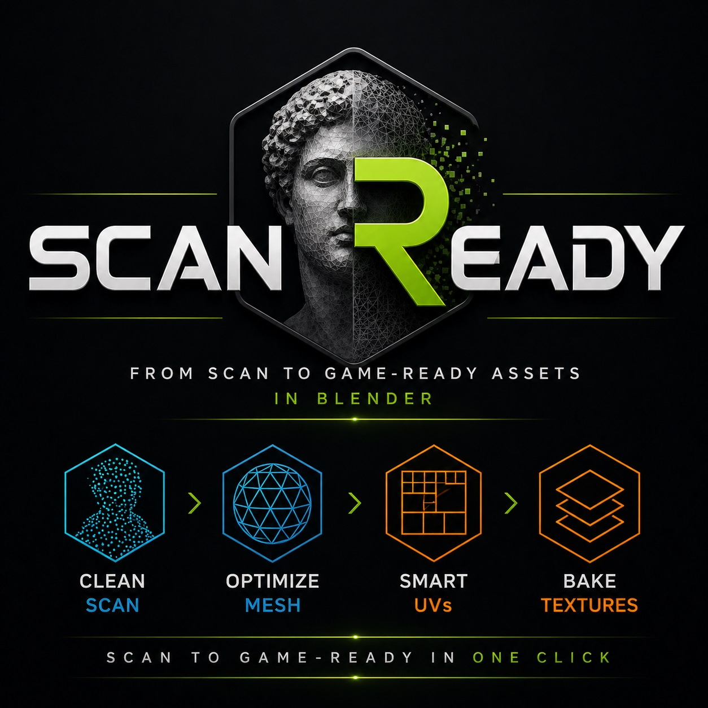
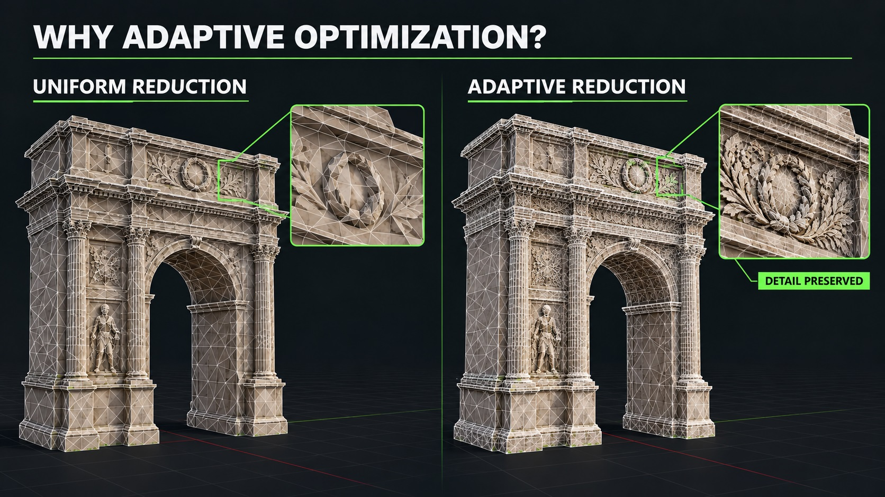
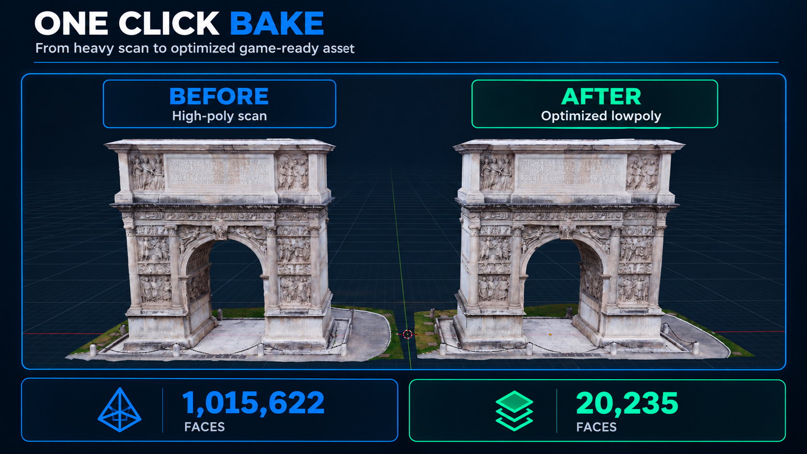
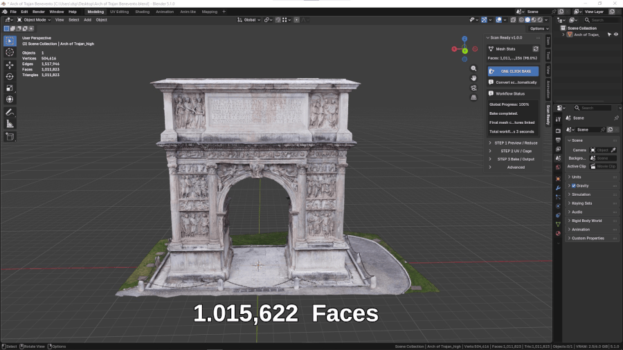

# ScanReady

Adaptive optimization and baking workflow for scans in Blender

  

 

ScanReady is a Blender add-on designed to turn heavy 3D scans into optimized assets ready for realtime use.

It is designed for 3D artists, asset creators, photogrammetry workflows, VR, video games, realtime visualization and interactive scenes.

Rather than treating the entire mesh in the same way, ScanReady uses an adaptive reduction workflow that helps protect silhouettes, edges, changes in shape and important details, while reducing flat or less important areas more aggressively.

  <b>High-poly scan -> Optimized mesh -> UVs -> Bake -> Realtime asset</b>

---

## Why ScanReady Is Different

Many optimization workflows use simple uniform reduction.

ScanReady instead uses **Adaptive Reduce** to distribute reduction more intelligently:

- Flat areas can be reduced more.
- Important details are better protected.
- Silhouettes and shape transitions remain clearer.
- Noisy scan surfaces can be simplified without immediately losing the object's identity.

  

  <b>Blender Decimate vs ScanReady Adaptive Reduce</b> 
  Same scan, similar final density. ScanReady reduces flat areas more aggressively and better protects details, edges and changes in shape.

---

## Why ScanReady?

Raw 3D scans can be very heavy:

- millions of polygons;
- many very high-resolution textures;
- many materials;
- poorly optimized UVs;
- materials not ready for realtime use;
- complex baking to set up manually;
- poor performance in VR, video games or interactive scenes.

ScanReady helps turn a heavy scan into a lighter asset by cleaning mesh imperfections and preparing UVs, materials and baked textures for production use.

---

## Before / After

Optimized for realtime workflows without unnecessarily wasting polygons.

  

  <b>From heavy photogrammetry scans to optimized assets ready for VR, video games, AR and realtime visualization.</b>

  

  <b>1M polygons -> optimized 20K game-ready mesh</b>

---

## One Click Bake

The **ONE CLICK BAKE** workflow automatically performs the main steps:

1. Clean the selected scan.
2. Create an optimized low-poly preview.
3. Generate UVs.
4. Estimate or prepare the cage.
5. Bake the textures.
6. Connect the final materials.
7. Save images if **Save Images** is enabled.

It is the fastest way to obtain a first version of the asset.

---

## Key Features

### Adaptive Optimization

**Adaptive Reduce** reduces flat areas more and protects important details, edges and silhouettes.

### One Click Workflow

**ONE CLICK BAKE** automatically performs cleanup, low-poly preview, UVs, cage, baking and final materials.

### Smart UV Workflow

ScanReady uses **Smart UV Project** to automatically generate UVs on the optimized mesh.

### Automatic Cage Generation

**Auto Cage Extrusion** estimates an initial cage distance by comparing the high-poly version with the low-poly version. This helps the cage cover important details to capture during baking, making the bake cleaner and easier to configure.

### Texture Baking

ScanReady supports **Base Color**, **Normal Map** and **Occlusion Map** baking. **Bake Roughness Map** appears when the source material has a connected Roughness input.

### Multi-Material Support

**Bake Materials** lets you split the bake across multiple materials when a large scan needs more texture space.

### Realtime Optimization

The workflow is designed for lighter assets intended for VR, video games, AR and realtime visualization.

### Memory-Safe Baking

**Safe Memory Bake** and **Force CPU Baking** help with heavy scenes and systems with limited VRAM.

### Reusable Presets

Presets let you save and reuse workflow setups for similar scans.

---

## Workflow Overview

ScanReady can be used in two ways:

- **One Click Bake**: complete automatic workflow.
- **Manual workflow**: separate control over reduction, UVs, cage and baking.

The manual workflow is useful when you want more control over the result:

### 1. Preview / Reduce

   Create an optimized mesh from the high-poly scan. With the default **Optimize / Reduce 0.10** value, the preview is reduced by approximately 90%.

### 2. UV / Cage

   Generate UVs and prepare the cage for baking.

### 3. Bake / Output

   Bake the textures and create the final asset.

---

## Designed for Realtime

ScanReady is designed to prepare assets for:

- VR and AR;
- video games;
- realtime visualization;
- interactive scenes;
- engines such as Unreal Engine, Unity, S2 Engine, Godot or realtime viewers;
- environments where polygons, memory and textures need to be kept under control.

---

## What ScanReady Creates

At the end of the workflow, ScanReady can create:

- a lighter asset than the original scan; the number of materials and textures depends on the chosen settings;
- an optimized final mesh;
- optimized UVs;
- final materials connected to textures;
- baked textures saved to disk;

---

## Compatibility

ScanReady is distributed as a **Blender Extension**.

It requires **Blender 4.2 or later**. See [Installation](installation.md) for the package and update procedure.

---

## Start Here

To get started:

- [Installation](installation.md)
- [Quick Start](quick-start.md)
- [One Click Bake](one-click.md)
- [Step 1 - Preview / Reduce](step1.md)
- [Step 2 - UV / Cage](step2.md)
- [Step 3 - Bake / Output](step3.md)

---

## Videos and Tutorials

See [Video Tutorials](video-tutorials.md) for tutorials in preparation and the recommended learning path.

[Mario Schiano 3D YouTube channel](https://www.youtube.com/@marioschiano3d)

---

## Support

For issues, questions or feedback:

**Email:** <support.marioschiano3d@gmail.com>
