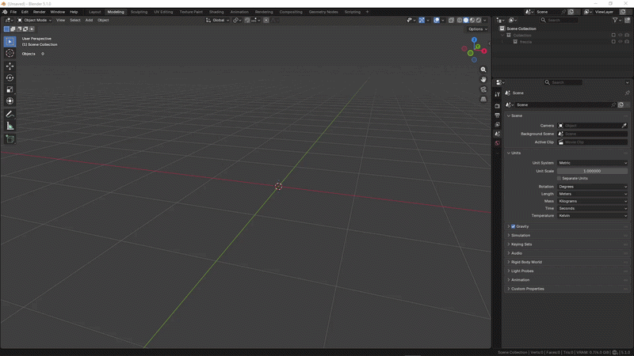

# Installation

This page explains how to install ScanReady in Blender.

## Requirements

ScanReady requires **Blender 4.2 or later** and is distributed as a Blender Extension. Save a copy of your project before processing the scan.

---

## Download the Add-on

Download the extension file:

`scanready_v1_0_0.zip`

Do not extract the ZIP.

Blender installs extensions directly from the `.zip` file.

---

## Install the Add-on

1. Open Blender.
2. Go to **Edit > Preferences**.
3. Open **Get Extensions**.
4. In the menu at the top right, choose **Install from Disk**.
5. Select `scanready_v1_0_0.zip`.
6. Enable **ScanReady**.

  

---

## Enable the Add-on

After installation, make sure ScanReady is enabled.

In Blender preferences you should see:

- **Name:** ScanReady
- **Type:** Extension
- **Version:** 1.0.0 or later
- **Maintainer:** Mario Schiano

---

## Open the ScanReady Panel

In the 3D Viewport:

1. Press `N` to open the sidebar.
2. Open the **Scan Ready** tab.
3. Select a high-poly mesh.
4. Press **ONE CLICK BAKE** or use the manual workflow.

---

## Updates

If you purchased ScanReady on **Superhive**, download the new ZIP from your account and install it using **Install from Disk**. ScanReady's built-in check does not download the package.

If ScanReady was installed from a repository or marketplace connected to Blender Extensions, Blender can show the **Update** button on the Extensions screen when a newer version is available.

ScanReady also includes a manual check under **Edit > Preferences > Add-ons > ScanReady**: **Check for Updates** reads the public documentation manifest and can report that a newer version exists. This check is informational: it does not install the update or replace Blender Extensions / Superhive.

Preferences also contains quick links to the documentation, release notes and tutorials.

---

## If the Panel Does Not Appear

Check that:

- the add-on is enabled in preferences;
- the installed file is the extension ZIP;
- Blender has been restarted after installation;
- you are looking at the 3D Viewport sidebar, not another editor.

See also the [FAQ](faq.md) and [Troubleshooting](troubleshooting.md).

For installation issues:

**Email:** <support.marioschiano3d@gmail.com>
