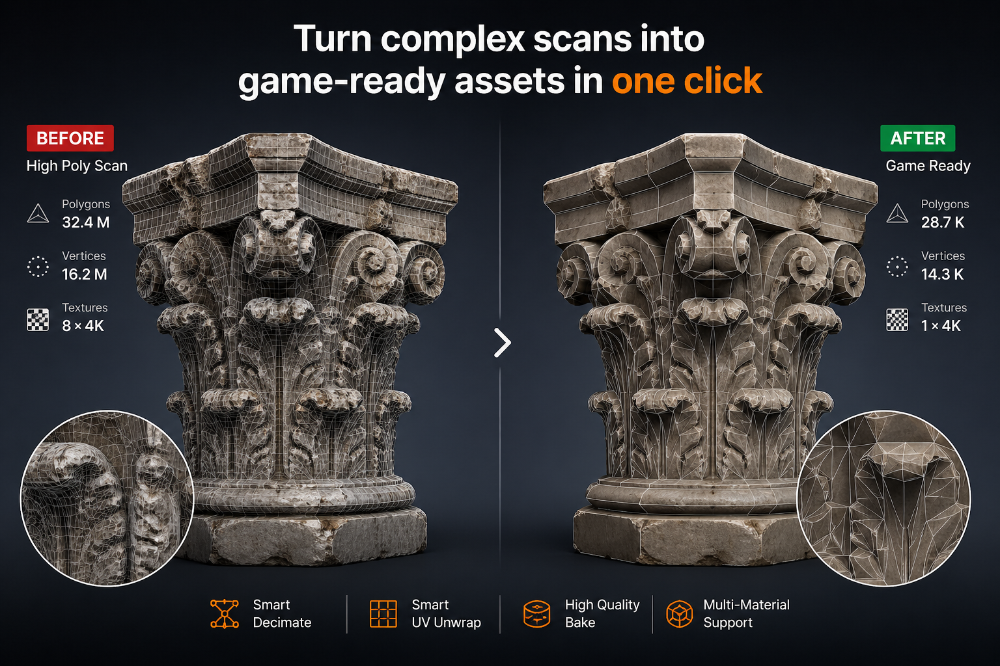

# Step 3 - Bake / Output

  

<b>Scansione high-poly -> mesh low-poly ottimizzata -> asset baked pronto per il realtime.</b>

---

Step 3 trasferisce il dettaglio texture dalla scansione high-poly originale alla mesh ottimizzata.

È la fase finale del workflow ScanReady, che trasforma l'oggetto low-poly in un asset più leggero e pronto per il realtime per:

- VR
- videogame
- AR
- visualizzazione in tempo reale
- ambienti interattivi

L'obiettivo è preservare gran parte dell'aspetto della scansione originale riducendo drasticamente la densità dei poligoni.

---

## Perché il bake è importante

Una scansione grezza spesso conserva il dettaglio tramite geometria estremamente pesante.

Anche se visivamente è impressionante, non è sempre pratica per l'uso realtime.

Il bake trasferisce le informazioni visive dalla scansione high-poly in texture map sulla mesh ottimizzata.

Questo permette all'asset finale di usare:

- meno poligoni;
- geometria più leggera;
- dettaglio basato su texture;
- asset più gestibili;
- migliori performance realtime.

Invece di renderizzare milioni di poligoni in realtime, ScanReady trasferisce il dettaglio della superficie nelle texture.

Questo permette alla mesh ottimizzata di restare leggera pur conservando gran parte dell'aspetto originale.

---

## Impostazioni texture

### Texture Preset / Texture Size

Imposta la risoluzione di output delle texture bake.

Valori più alti preservano più dettaglio, ma aumentano tempo di bake, uso memoria e dimensione dei file.

Scelte comuni:

- `1024` -> asset leggeri
- `2048` -> asset generici
- `4096` -> asset ravvicinati o ad alto dettaglio
- `8192` -> asset molto grandi o osservati da vicino, se memoria e sorgente lo consentono

Risoluzioni più alte aumentano molto l'uso di memoria.

<!-- Sostituire il placeholder con ../../img/step3-texture-size-comparison.png -->

  

---

### Bake Materials

Divide il bake in più gruppi di materiali.

Usare più materiali aumenta lo spazio texture disponibile e può conservare più dettaglio su scansioni grandi.

  

| Materiali | Uso tipico |
|---|---|
| 1 materiale | Asset leggeri |
| 2 materiali | Conservazione media del dettaglio |
| 4 materiali | Scansioni grandi e asset ad alto dettaglio |

Aumentare solo la densità dei poligoni non è sempre la soluzione migliore.

In molti casi, aumentare il numero di materiali bake produce texture più pulite e nitide mantenendo la mesh leggera.

!!! info "Bake multi-materiale"
    Quando **Bake Materials** è impostato su `2` o più materiali, ScanReady abilita automaticamente **Force CPU Baking** come default più sicuro per workflow multi-materiale.

    Puoi comunque disabilitarlo manualmente se la tua GPU può gestire il bake in sicurezza.

---

## Analisi Texture Detail

L'analisi **Texture Detail** è disponibile in **Advanced**.

Usa **Analyze Texture Detail** dopo aver generato le UV quando vuoi stimare se il setup di bake corrente può preservare abbastanza dettaglio texture.

ScanReady cerca la sorgente high-poly corrispondente e la mesh UV ottimizzata, poi confronta l'uso delle texture originali con il setup bake corrente.

Mostra **Texture match**, **Detail estimate** e **UV Space**, insieme a un consiglio su risoluzione e numero di materiali. Sono stime del dettaglio disponibile, non una garanzia della qualità finale.

  

È utile quando devi decidere se:

- mantenere un solo materiale bake;
- aumentare **Bake Materials**;
- alzare o abbassare **Texture Size**;
- migliorare il packing UV prima del bake.

Se ScanReady non riesce a trovare automaticamente una coppia high-to-UV corrispondente, analizza la mesh attiva.

---

## Controllo cage prima del bake

!!! warning "Controlla il cage prima del bake"
    Prima del bake, controlla che il cage copra completamente la superficie della scansione high-poly.

    Se il cage è troppo piccolo, i raggi di bake possono perdere dettagli e produrre aree nere, dettagli mancanti o proiezioni errate.

    Abilita **Show Cage** e controlla la preview del cage. Poi aumenta leggermente **Cage Extrusion** oppure usa **Auto Cage Extrusion**.

    Usa il valore di cage più piccolo che cattura i dettagli della scansione senza proiettare superfici vicine indesiderate.

---

### Bake Samples

Controlla i samples di bake Cycles.

Valori più alti possono ridurre il rumore, soprattutto per Ambient Occlusion, ma aumentano anche il tempo di bake.

---

### Bake Margin

Aggiunge padding in pixel attorno alle isole UV bake.

Aiuta a ridurre seam visibili e texture bleeding.

---

## Mappe bake

### Bake Base Color

Cuoce le informazioni diffuse o colore dalla scansione originale.

È attiva per impostazione predefinita ed è di solito la texture più importante per preservare l'aspetto dell'oggetto catturato.

---

### Bake Normal Map

Cuoce una normal map.

Le normal map preservano l'aspetto del dettaglio di superficie senza mantenere la geometria high-poly originale.

Questo è particolarmente utile per asset VR e videogame, dove la geometria deve restare leggera.

Se il materiale high-poly originale contiene già una normal map collegata, ScanReady trasferisce quella texture normal sul nuovo layout UV.

Se non viene trovata una normal map collegata, ScanReady esegue un bake geometrico high-to-low della normal.

Le texture normal vengono trattate come dati tecnici **Non-Color**.

Il controllo materiale **Normal Strength** è disponibile in **Advanced > Bake Settings** quando **Bake Normal Map** è attivo.

---

### Bake Roughness Map

Cuoce o trasferisce le informazioni roughness dal materiale high-poly.

Usalo quando il materiale originale contiene già informazioni roughness che devono essere preservate sull'asset low-poly finale.

!!! info "Bake Roughness Map"
    La spunta **Bake Roughness Map** viene mostrata solo quando ScanReady trova un input Roughness collegato nel materiale high-poly.

    Se il materiale sorgente non ha una roughness collegata, ScanReady non può trasferirla e l'opzione non viene mostrata.

Anche le texture roughness vengono gestite come dati tecnici **Non-Color**.

---

### Bake Occlusion Map

Cuoce una mappa Ambient Occlusion.

L'AO può aiutare ad aggiungere ombre di contatto e profondità di superficie al materiale finale.

Il controllo materiale **AO Mix** è disponibile in **Advanced > Bake Settings > Occlusion Settings** quando **Bake Occlusion Map** è attivo. Il valore predefinito è `1.0`, che applica l'intera texture AO bake al materiale finale.

---

  

---

## Impostazioni output

### Save Images

Salva le texture bake su disco.

Abilitalo quando esporti asset per game engine, archivi, workflow esterni o consegna finale.

---

### Open Folder After Bake

Apre automaticamente la cartella del bake quando **Save Images** è attivo e il salvataggio delle texture è completato.

È utile quando vuoi controllare subito i file generati, copiarli in un progetto esterno o portarli in un game engine.

---

### Image Format

Formati di output disponibili:

- **JPG** -> texture Base Color compatte
- **PNG** -> output texture lossless
- **TIFF** -> workflow a precisione più alta

PNG è generalmente consigliato per la maggior parte dei workflow in tempo reale.

---

### JPG Quality

Controlla la qualità di compressione JPG.

Valori più alti preservano più dettaglio immagine, ma generano file più grandi.

---

### TIFF 16-bit

Salva texture TIFF con precisione più alta.

Utile per asset ad alto dettaglio, workflow di archivio o normal map dettagliate.

---

### Output Folder

Definisce dove vengono salvate le texture bake.

Percorsi relativi come <code>//bake/</code> vengono salvati accanto al file Blender corrente.

Quando scegli o modifichi il percorso, ScanReady mostra la cartella di destinazione nel riquadro <strong>Bake Folder</strong>. Dopo il bake puoi usare il pulsante cartella per aprire rapidamente la posizione dei file generati.

  
<strong>Output Folder</strong>

  

---

### Bake Folder

Lo Step 3 include il riquadro **Bake Folder**. Prima del primo salvataggio può mostrare **No bake folder yet**.

Mostra la cartella usata dall'ultimo bake e include un pulsante cartella che la apre direttamente nel file browser del sistema operativo.

!!! tip "Output Folder e Bake Folder"
    Usa **Output Folder** per scegliere dove ScanReady deve salvare le texture.

    Usa **Bake Folder** dopo il bake per aprire rapidamente la cartella realmente usata.

---

## Quando avviare il bake

Clicca **Bake Textures** quando UV, cage, texture size, materiali e mappe bake sono pronti.

Le scansioni grandi possono richiedere diversi minuti in base a:

- risoluzione texture;
- numero di materiali;
- impostazioni bake;
- performance hardware.

Quando il bake è completo, controlla il materiale finale e usa **Bake Folder** per aprire le texture salvate.

---

## Cosa controllare

Dopo il bake, controlla:

- Texture Base Color;
- Normal Map;
- Mappa Ambient Occlusion;
- Nitidezza texture;
- Seam texture;
- Dettagli mancanti;
- Proiezioni errate;
- Aspetto del materiale finale;
- File output salvati;
- Bake Folder apre l'ultima cartella texture salvata.

!!! tip "Se il bake va corretto"
    Se mancano dettagli, abilita **Show Cage** e aumenta leggermente **Cage Extrusion** oppure usa **Auto Cage Extrusion**.

    Se il bake è troppo morbido o povero di dettaglio, aumenta la risoluzione texture prima di rifare il bake.

    Se la mesh finale è ancora troppo pesante, puoi tornare a **Step 1 - Preview / Reduce** anche dopo essere arrivato allo Step 3. Abbassa **Final Faces** o **Optimize / Reduce**, clicca di nuovo **Create Lowpoly Preview**, poi esegui di nuovo **Generate UVs** e **Bake Textures**. Il bake dovrebbe sempre usare la mesh UV ottimizzata più recente.

---

## Ottimizzazione realtime

  

Per workflow in tempo reale, il risultato finale dovrebbe bilanciare qualità visiva e performance.

Un buon asset bake dovrebbe:

- usare una mesh leggera;
- preservare l'aspetto riconoscibile della scansione originale;
- usare le texture per portare il dettaglio di superficie;
- essere più facile da esportare;
- essere più facile da renderizzare in VR e game engine;
- evitare densità geometrica inutile.

Il bake è ciò che permette a una mesh ottimizzata leggera di conservare gran parte della ricchezza visiva della scansione high-poly originale.

