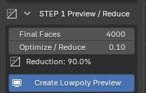
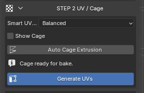
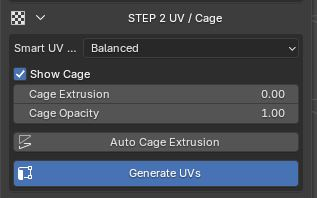
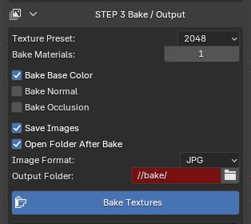

# Manual Quick Guide

Use this guide when you want to follow ScanReady step by step instead of using **One Click Bake**.

The manual workflow lets you control reduction, UVs, cage and baking separately. It is useful when you want to decide more precisely how much to optimize the mesh, how to generate UVs and which textures to create.

---

## Step 1 - Create the Low-poly Preview

  <ol>
    <li>Select the high-poly scan in Blender's viewport.</li>
    <li>Open <strong>STEP 1 Preview / Reduce</strong>.</li>
    <li>Adjust <strong>Optimize / Reduce</strong> or <strong>Final Faces</strong> if you want a lighter or more detailed mesh.</li>
    <li>Click <strong>Create Lowpoly Preview</strong>.</li>
  </ol>
  
ScanReady prepares the high-poly source and creates a separate preview to which reduction is applied. UVs are generated from the preview; the high-poly remains the reference for cage and baking.

  
Preparation options can combine parts, clean the source, correct normals or convert materials. Keep a copy of the original file before starting.

  
When the preview looks correct, continue to <strong>Step 2 - UV / Cage</strong>.

  
<strong>Create Lowpoly Preview</strong>

  

---

## Step 2 - Generate UVs and Check the Cage

  <ol>
    <li>Start with the low-poly preview created in Step 1.</li>
    <li>Open <strong>STEP 2 UV / Cage</strong>.</li>
    <li>Click <strong>Generate UVs</strong>.</li>
  </ol>
  
ScanReady creates a new UV layout on the optimized mesh. This prepares the asset to receive baked textures on the new low-poly surface.

  
After generating UVs, prepare the cage for baking:

  <ul>
    <li>use <strong>Auto Cage Extrusion</strong> for an automatic estimate;</li>
    <li>adjust <strong>Cage Extrusion</strong> if you need to correct the distance manually;</li>
    <li>check coverage of the high-poly; green indicates that the automatic check passed, but still inspect thin and concave areas before baking.</li>
  </ul>

  

    
<strong>Generate UVs</strong>

    
  

  

    
<strong>Show Cage / Cage Controls</strong>

    
  

---

## Step 3 - Bake

  <ol>
    <li>Open <strong>STEP 3 Bake / Output</strong>.</li>
    <li>Choose <strong>Texture Preset / Texture Size</strong>.</li>
    <li>Choose how many <strong>Bake Materials</strong> to use.</li>
    <li>Enable the maps you want to generate, such as <strong>Bake Base Color</strong>, <strong>Bake Normal Map</strong>, <strong>Bake Roughness Map</strong> or <strong>Bake Occlusion Map</strong>.</li>
    <li>Click <strong>Bake Textures</strong>.</li>
  </ol>
  
ScanReady bakes one texture at a time, connects the generated textures to the final material and creates a lighter asset ready for realtime, VR, video games, AR and interactive scenes.

  

    
Bake Roughness Map

    
The <strong>Bake Roughness Map</strong> checkbox is shown only if the high-poly material has a connected Roughness input.

    
If no roughness is connected, ScanReady cannot transfer it and the checkbox is not shown.

  

  
Before clicking <strong>Bake Textures</strong>, check that the cage covers the high-poly scan. If the cage is too small, black areas, missing details or incorrect projections may appear.

  
<strong>Bake Textures</strong>

  

---

## If You Want More Optimization

!!! tip "You can return to Step 1"
    You can go back at any time.

    If you are already in Step 2 or Step 3 and notice that the mesh is still too heavy, return to **Step 1 - Preview / Reduce**, lower **Final Faces** or **Optimize / Reduce**, then click **Create Lowpoly Preview** again.

After recreating the preview, continue forward again:

1. return to **Step 2 - UV / Cage**;
2. click **Generate UVs** again;
3. check the cage;
4. return to **Step 3 - Bake / Output**;
5. click **Bake Textures**.

!!! note "Updated UV mesh"
    The bake should always use the most recent optimized UV mesh.

---

## When to Use the Detailed Step Pages

This page tells you what to press and in which order.

To understand each stage better, use the dedicated pages:

- [Step 1 - Preview / Reduce](step1.md) for Adaptive Reduce, Optimize / Reduce, Final Faces and preview.
- [Step 2 - UV / Cage](step2.md) for Smart UV Project, checker, cage and Auto Cage Extrusion.
- [Step 3 - Bake / Output](step3.md) for texture size, bake materials, bake maps, output and image saving.
