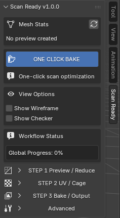

# One Click Bake

  

    
<strong>ONE CLICK BAKE</strong> is ScanReady's fastest workflow.

    
It is designed to convert a heavy high-poly scan into a lighter asset with baked textures and minimal setup. It is useful when preparing scanned models for <strong>VR, AR, video games, realtime visualization or interactive scenes</strong>.

  

  

    
<strong>ONE CLICK BAKE</strong>

    
  

  

Instead of manually reducing the mesh, generating UVs, preparing the cage and configuring the bake, ScanReady automatically performs the main process.

By default ScanReady starts with **Optimize / Reduce** set to **0.10**. This means the low-poly preview keeps approximately **10% of the original polygons**, producing approximately **90% fewer polygons**.

This value works well for many VR, game and realtime assets. If the result needs more or less detail, adjust the value manually in **Step 1 - Preview / Reduce** after creating the low-poly preview.

!!! tip "One Click Bake does not lock you in"
    One Click Bake is automatic, but the result can still be refined afterwards.

    If the final model is too heavy, or has been optimized too much and loses important shape details, return to **Step 1 - Preview / Reduce**. Adjust **Optimize / Reduce** or **Final Faces**, then click **Create Lowpoly Preview** again.

    ScanReady rebuilds the optimized preview with the new settings so you can try a lighter or more detailed version before continuing with UVs and baking.

    The workflow is flexible: even if you are already in **Step 2 - UV / Cage** or **Step 3 - Bake / Output**, you can return to Step 1, adjust reduction, click **Create Lowpoly Preview**, then continue forward again.

---

## What One Click Bake Does

When you click **ONE CLICK BAKE**, ScanReady performs the complete scan-to-asset workflow:

1. Prepares the selected scan according to the enabled **Mesh Settings** options: it can combine parts, correct normals and remove unwanted fragments.
2. Creates a low-poly preview from the cleaned high-poly scan.
3. Performs pre-decimate merge cleanup on the duplicated preview mesh when needed.
4. Reduces geometry to make the model lighter.
5. Generates UVs for the optimized object.
6. Creates or estimates the baking cage.
7. Bakes texture details from the original scan.
8. Builds the final material setup.
9. Saves baked textures if **Save Images** is enabled, as it is by default.

The aim is to preserve the original scan's visual identity while making the model easier to use in realtime projects.

  

---

## Why It Matters

Scans can be too heavy for realtime production.

A scan may look good but be difficult to use because it can have:

- too many polygons;
- textures that are too large;
- too many materials;
- slow viewport performance;
- no optimized UVs;
- a complex bake setup;
- high memory usage;
- mesh density unsuitable for VR or video games.

One Click Bake helps reduce this complexity.

It gives you a faster way to turn captured geometry into a cleaner, lighter asset with baked textures.

---

## Workflow Stages

During the operation, ScanReady goes through the same main stages used by the manual workflow.

### Cleanup

Applies the preparation options enabled in **Mesh Settings**. Check the result when the scan contains separate parts you want to keep.

### Preview

Cleans the selected scan and creates the optimized low-poly preview.

### UV Mapping

Generates UVs for the optimized mesh.

### Cage

Estimates cage extrusion so the bake can project details from the original scan.

### Bake

Bakes the selected textures and prepares the final result.

The panel shows workflow status and overall progress while the process is running.

---

## Stopping the Process

!!! info "Stop with Esc"
    If you start **ONE CLICK BAKE** by mistake, you can press **Esc** to stop the workflow.

    ScanReady stops the process as soon as the current step finishes. This lets you stop an accidental start without waiting unnecessarily, while avoiding leaving the scene in an incomplete state during delicate operations such as mesh cleanup, UV generation or cage setup.

    Once **Step 3 - Bake** has started, ScanReady allows baking and finalization to complete safely. This reduces the risk of partial textures, unconnected materials or an incomplete final mesh.

    After stopping, you can start **ONE CLICK BAKE** again: ScanReady checks the steps that are already valid and resumes from the appropriate point.

---

## When to Use One Click Bake

Use One Click Bake when:

- you want the fastest route from scan to optimized asset;
- you are working with standard photogrammetry scans;
- you need a lighter asset for VR, video games or realtime visualization;
- you do not need to control every step manually;
- you want a quick first version before manual refinement.

---

## Before You Click

For better results:

- save a copy of the project and select the high-poly mesh or the parent of the imported hierarchy; keep **Auto Combine Mesh Parts** enabled if the parts should be treated as one asset;
- set **Optimize / Reduce** or **Final Faces** if you know the target mesh density;
- choose **Texture Size** according to the detail needed: 512, 1K, 2K, 4K or 8K;
- keep **Bake Base Color** enabled or enable **Bake Normal Map**, **Bake Roughness Map** and **Bake Occlusion Map** only for the maps you want to generate;
- set the **Output Folder** if you want to save textures to a specific folder on disk.

For scans with large continuous surfaces, the **Flat Surfaces** Adaptive Reduce preset can be useful before baking because it allows simple areas to be simplified more aggressively.

For mixed scans, use **Best Quality** with **Balanced** and check Show Adaptive Weights before continuing.

---

## After Baking

After the workflow completes, check:

- the density of the final mesh;
- the object's silhouette;
- the baked material;
- saved texture files;
- the **Bake Folder** shortcut in Step 3, which opens the latest texture output folder;
- Normal Map, Roughness Map and Occlusion Map if enabled;
- any missing details caused by cage distance or bake settings.

If the result needs adjustment, use the manual workflow:

- **Step 1 - Preview / Reduce**
- **Step 2 - UV / Cage**
- **Step 3 - Bake / Output**

The manual steps give you more control over the same process.

---

## Meshes Created by One Click Bake

At the end of the workflow, One Click Bake leaves the meshes created during the various steps in the Outliner. The original mesh keeps the <strong>_high</strong> suffix, while the mesh ready for the final result uses the <strong>3_</strong> prefix and <strong>_final</strong> suffix.

The starting numbers help you quickly recognize which stage each mesh belongs to: <strong>1_</strong> preview, <strong>2_</strong> cage and UVs, <strong>3_</strong> final mesh.

