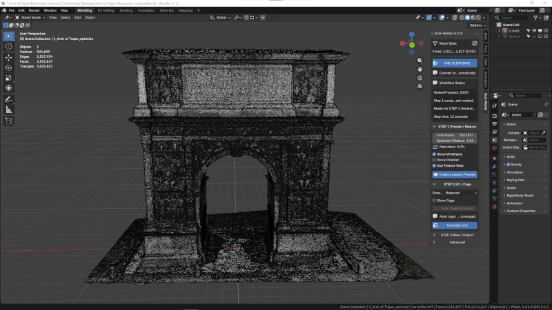
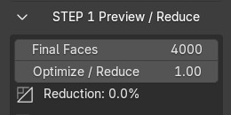
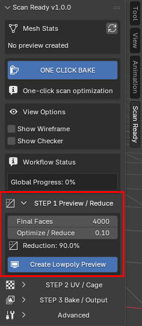
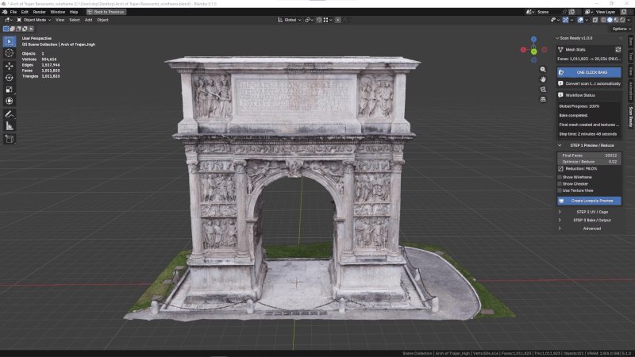
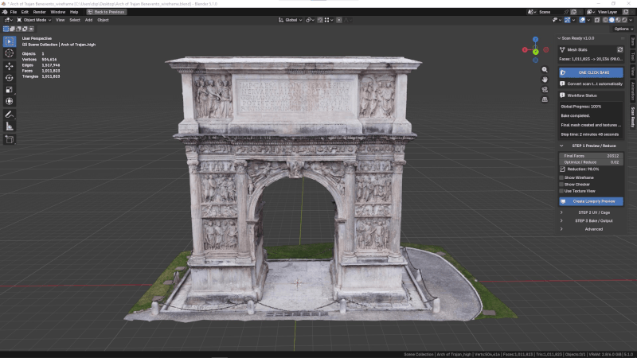
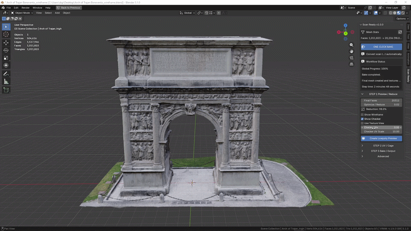
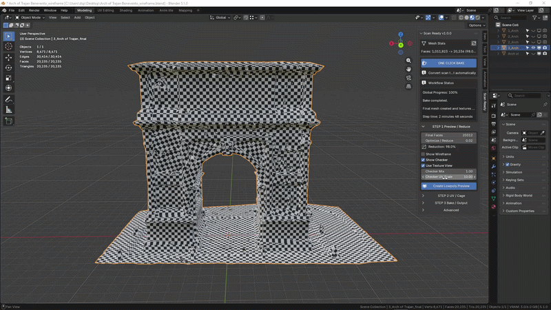
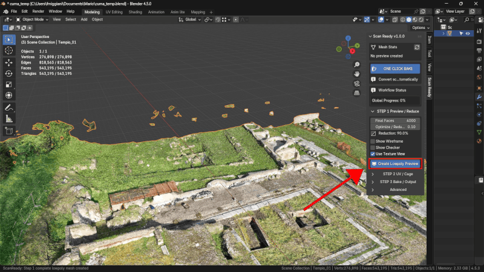

# Step 1 - Preview / Reduce

Create a lightweight, optimized preview from the high-poly scan.

Processing time depends on scan density and computer performance: a scan with millions of polygons can take around a minute or more on a mid-range PC.

  

Optimize / Reduce controls how much geometry is kept in the low-poly preview. The default value of 0.10 creates a preview with approximately 90% fewer polygons.

---

## Adaptive Optimization

Optimization is not applied uniformly across the whole model.

ScanReady preserves important surface detail while simplifying flat or less detailed regions more aggressively.

This helps create cleaner, more efficient low-poly assets for realtime workflows.

### Adaptive Reduce

Adaptive Reduce is enabled by default and helps ScanReady distribute polygon reduction more intelligently across the scan.

Instead of treating every surface alike, it allows flat areas to be reduced more and protects regions where surface detail is more important.

This is the main difference between a simple Blender Decimate pass and the ScanReady workflow. Standard decimation can reduce useful edges and noisy flat regions with the same priority. ScanReady first creates adaptive weights, then uses them to reduce broad surfaces more aggressively while better protecting strong normal changes, silhouettes, edges and important shape transitions.

### Viewing Adaptive Weights

The same model can be displayed with its normal material or in **Show Adaptive Reduction** mode. Colors show where ScanReady tends to protect detail and where it can reduce geometry more aggressively.

  

    
    

      
    

    Original scan
    Adaptive reduction
    Minimum reductionMedium reductionHigh reduction
    <button class="sr-uv-compare__handle" type="button" aria-label="Compare the original scan and Adaptive Reduce weights" aria-valuemin="0" aria-valuemax="100" aria-valuenow="50"></button>
  

<strong>Blue:</strong> preserved detail. <strong>Red:</strong> greater polygon reduction.

<strong>Move the slider to compare the scan and the distribution of adaptive weights.</strong>

### Geometry Comparison

  

    
    

      
    

    101,177 faces
    Blender Decimate
    ScanReady Adaptive Reduce
    <button class="sr-uv-compare__handle" type="button" aria-label="Compare Blender Decimate and ScanReady Adaptive Reduce" aria-valuemin="0" aria-valuemax="100" aria-valuenow="50"></button>
  

<strong>Move the slider to compare the distribution of geometry.</strong>

At the same face count, Adaptive Reduce tends to reduce flat surfaces more aggressively while retaining more geometry in areas with reliefs, edges and decorations. ScanReady uses Blender Decimate, guiding its reduction with adaptive weights.

Use an Adaptive Reduce preset as a quick starting point:

- **Balanced** for most scans and general realtime assets.
- **Preserve Details** when the scan contains important folds, sculptural forms, engravings or close-up details.
- **Flat Surfaces** when the object contains broad simple areas that can be simplified more aggressively.

Keep **Adaptive Method** on **Best Quality** for normal work. **Legacy** retains the original Adaptive Reduce calculation for compatibility with older projects.

  

  <b>Blender Decimate vs ScanReady Adaptive Reduce</b> 
  Illustrative comparison in preparation: same scan and similar final density.

## Performance Improvement

Heavy scans can quickly become difficult to manage in Blender.

### Example

- Original scan: over 1 million polygons.
- Possible test target: 20,000 polygons.

This is an example, not a guaranteed result: choose the target based on silhouette, viewing distance and target platform.

This helps improve viewport responsiveness and makes the asset easier to process in realtime workflows.

---

## Separate Preview and High-poly Source

Reduction is applied to a **separate preview**, while the high-poly mesh remains available as the bake source.

!!! warning "Keep a copy of the original scan"
    Preparation can modify the source: apply scale, combine parts, correct normals, remove sharp markings or fragments and convert materials, depending on enabled options.

    Save a copy of the `.blend` file before Step 1, especially if you need an archival original.

---

## Why Reduction Matters

High-poly scans are often too heavy for direct use.

They can cause:

- slow viewport performance;
- heavy Blender scenes;
- difficult exports;
- poor realtime performance;
- VR assets too dense to display smoothly;
- game objects too heavy and difficult to manage in production.

Preview / Reduce creates a lighter version of the scan before continuing with UVs and baking.

It also helps remove small mesh artifacts generated by photogrammetry or 3D capture, such as detached polygons, isolated vertices and floating fragments.

---

Step 1 creates an optimized low-poly preview from the selected high-poly scan.

This is the first important step when preparing a scanned object for **VR, AR, video games, realtime visualization or interactive scenes**.

ScanReady first cleans common unwanted scan fragments, then reduces the model while preserving the original scan's overall shape and visual identity.

---

<h3>Optimize / Reduce</h3>

The default value is <strong>0.10</strong>.

It keeps approximately <strong>10% of the original polygons</strong>, creating a lighter low-poly preview with approximately <strong>90% fewer polygons</strong>.

After clicking <strong>Create Lowpoly Preview</strong>, you can still adjust this value to try lighter or more detailed results.

Very dense scans with millions of polygons may still take time to process.

Realtime updates depend on scan complexity and Blender performance.

  
<strong>Optimize / Reduce</strong>

  

---

## Main Settings

<h3>Final Faces</h3>

Sets the target face count for the optimized low-poly mesh.

Use lower values for lightweight VR or game assets.

Use higher values when the object needs to retain more silhouette detail.

<h3>Optimize / Reduce</h3>

Controls how much ScanReady reduces the selected high-poly scan.

The default value is <strong>0.10</strong>, which keeps approximately <strong>10% of the original polygons</strong>.

Lower values produce lighter assets.

Higher values preserve more shape detail.

<h3>Reduction</h3>

Shows the current reduction percentage based on the selected optimization settings.

  
<strong>Create Lowpoly Preview</strong>

  

---

## View Options

  
<strong>View Options</strong>

  

In the current ScanReady panel, **Show Wireframe** and **Show Checker** appear before **STEP 1**.

These preview tools help check topology and UV readability without changing the baking workflow.

---

## Show Wireframe

Shows the topology of the preview object.

Use it to check whether the mesh is still too dense or has been reduced too aggressively.

  

---

## Show Checker

Shows a checker texture on the preview mesh.

It helps check UV density and texture distortion.

  

---

## Checker Mix / Checker UV Scale

<h3>Checker Mix</h3>

Controls how strongly the checker overlay appears on the model's surface.

<h3>Checker UV Scale</h3>

Changes the size of the checker squares.

Smaller squares make UV stretching and distortion easier to see.

Larger squares are useful for quick general checks.

  
<strong>Checker Mix / Checker UV Scale</strong>

  

  

Checker Mix adjusts how visible the checker overlay is on the model's surface.

  

Checker UV Scale changes the checker pattern size to make UV stretching easier to inspect.

---

## When to Recreate the Preview

!!! tip "When to return to Step 1"
    Use **Create Lowpoly Preview** again when you change density or want to test a different reduction.

    If the preview is too heavy or too simplified, adjust **Optimize / Reduce** or **Final Faces** and recreate it.

    You can return to Step 1 at any time. If you are already in Step 2 or Step 3 and decide the model needs to be lighter or more detailed, change reduction settings here, click **Create Lowpoly Preview** again, then generate UVs and bake again.

  

ScanReady cleans the selected high-poly scan, removes common mesh noise such as detached polygons or isolated vertices, then creates an optimized preview object.

Before the Decimate modifier is added, ScanReady can also perform **Pre-Decimate Merge** cleanup on the duplicated preview mesh. This helps reduce overlapping scan polygons before optimization.

When the preview is correct, continue with:

[Step 2 - UV / Cage](step2.md)

---

## What to Check

After creating the preview, check:

- overall silhouette;
- important edges and shape details;
- polygon density;
- wireframe readability;
- whether the scan is light enough for the target platform;
- whether too much visual information has been lost.

!!! note "Reading the preview"
    If the preview is too heavy, reduce it further.

    If the preview loses important shape details, increase the target density and recreate it.

---

## Realtime Optimization Goals

For VR and video game workflows, the goal is not visual quality alone.

The asset must remain light enough for smooth realtime performance.

A good preview should:

- preserve the recognizable shape of the original scan;
- remove unnecessary scan density;
- improve Blender viewport responsiveness;
- be suitable for UV generation;
- be ready for texture baking in the next step.

---

## Mesh Created at the End of Step 1

The mesh created at the end of Step 1 receives the <strong>1_</strong> prefix.

<strong>1_MeshName_preview</strong> identifies the optimized preview mesh used as the basis for subsequent steps.

